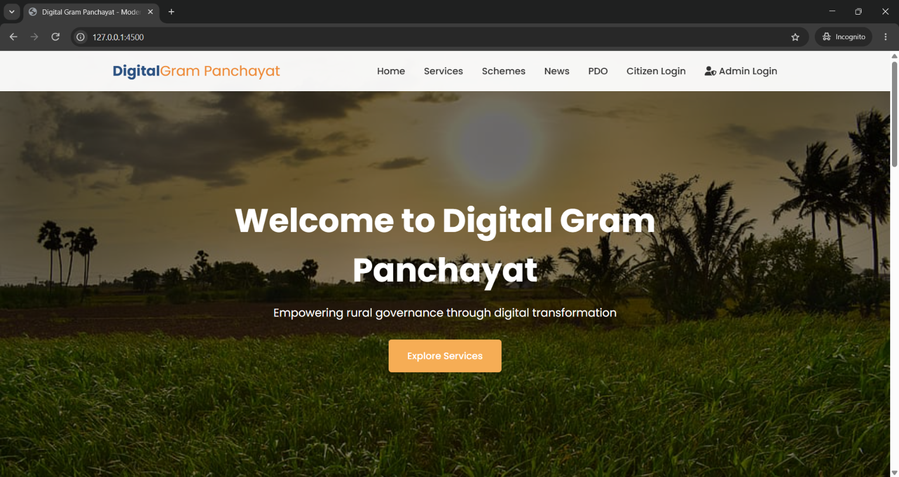
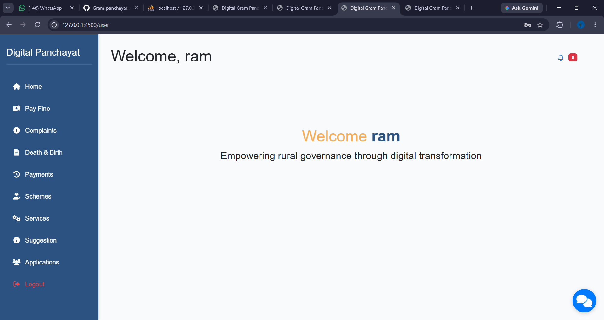
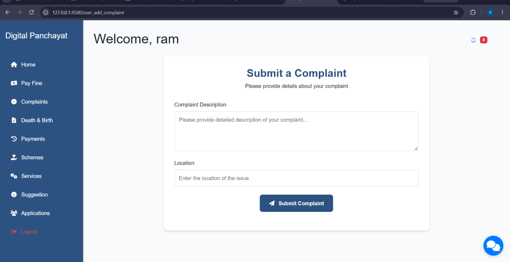
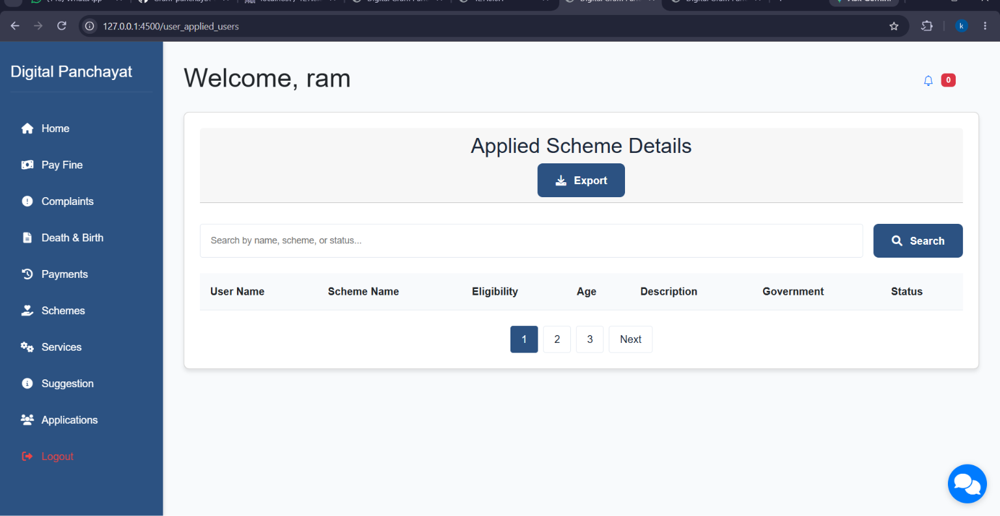
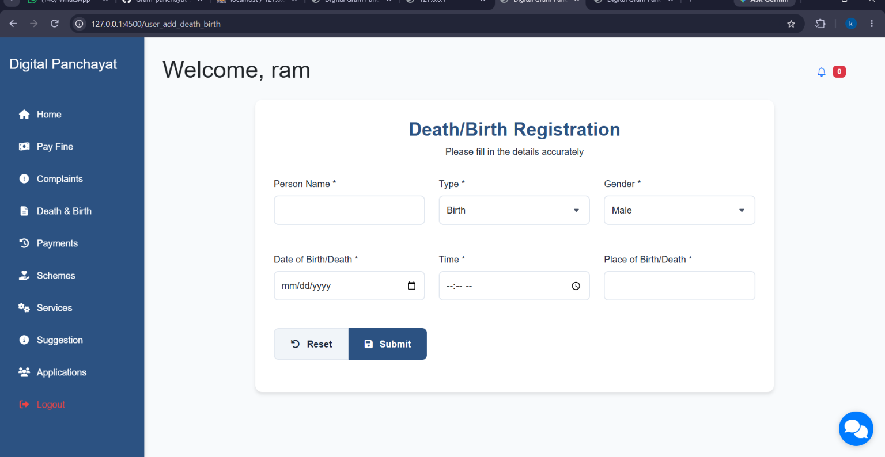
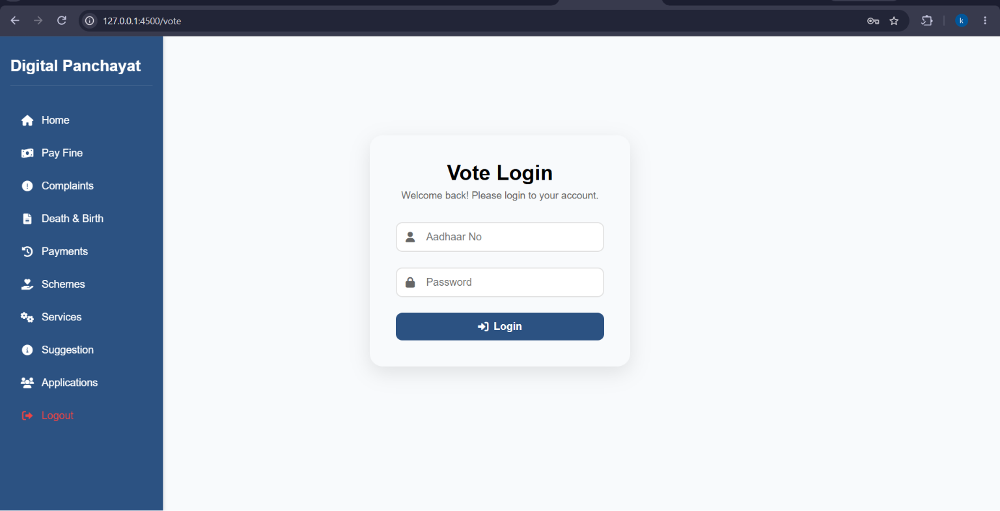
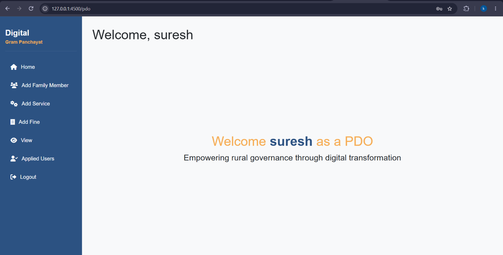
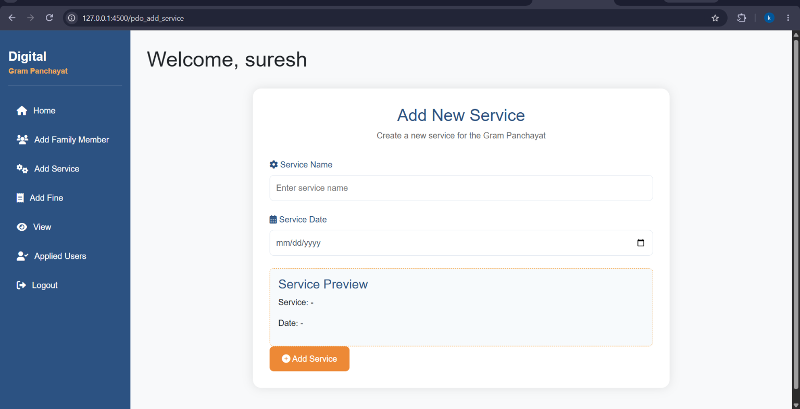
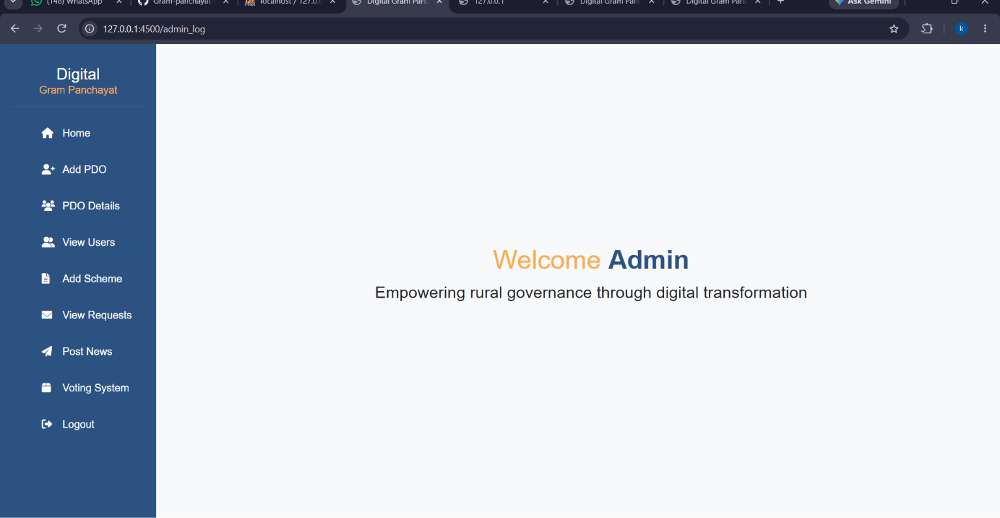
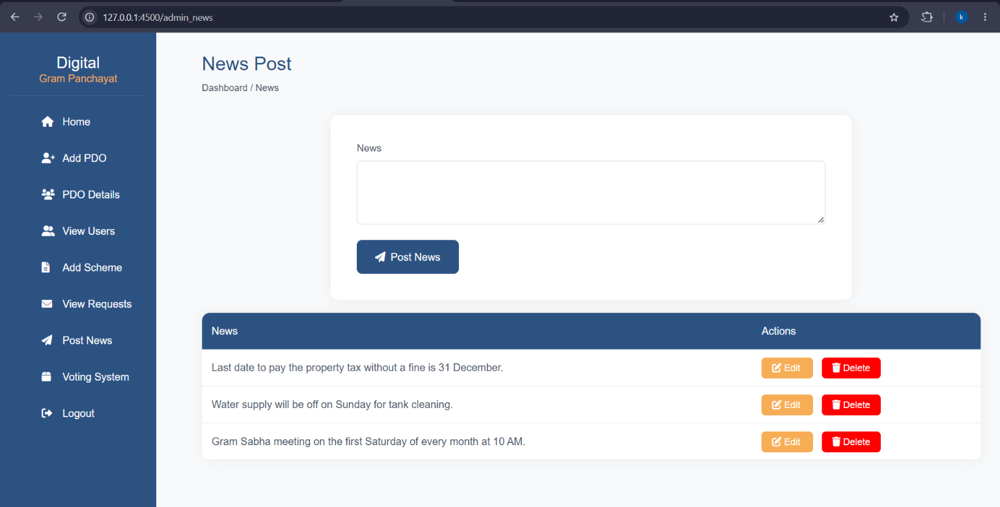

# Digital Gram Panchayat: E-Services System
**Live demo:** [https://YOUR-LINK.onrender.com](https://gram-panchayat-c6ga.onrender.com)

> Hosted on free plans (Render for the app, TiDB Cloud for the MySQL database), so the first page load can take up to a minute. All data is fake demo data.
>
> Demo logins: citizen `ram` / `123456`, PDO `suresh` / `12345678`. The admin login is available on request.

A web application built with **Python and Flask** that digitizes everyday services of a Gram Panchayat (village administration). Villagers can use the portal instead of visiting the office for each task, and the Panchayat Development Officer (PDO) and admin manage everything from their own dashboards.

This was my B.E. final-year project. It was demonstrated locally, and I have since improved its security and code quality (see below).

## Screenshots

**Public and citizen**

| Home                          | Citizen dashboard                                       | Complaint                               |
| ----------------------------- | ------------------------------------------------------- | --------------------------------------- |
|  |  |  |

| Schemes                             | Birth and death registration                                 | Voting                            |
| ----------------------------------- | ------------------------------------------------------------ | --------------------------------- |
|  |  |  |

**PDO and admin**

| PDO dashboard                                   | PDO adds a service                                     | Admin dashboard                                     | Admin posts news                                |
| ----------------------------------------------- | ------------------------------------------------------ | --------------------------------------------------- | ----------------------------------------------- |
|  |  |  |  |

## Features

**Citizens**

- Register and log in
- File complaints and track their status
- View and apply for government schemes, and check application status
- View and pay fines online, and see payment history
- Register births and deaths
- View village services and the public notice board
- Send suggestions to the PDO and receive notifications when they are seen
- Ask a built-in help chatbot (predefined questions)
- Vote in a village election while the admin has voting open (each family has a limited number of votes)

**PDO (Panchayat Development Officer)**

- Add, view, edit and delete family records
- Add services and fines
- Review complaints and record the action taken
- Approve birth and death registrations and scheme applications
- Read and clear citizen suggestions
- View payments and daily reports

**Admin**

- Add and manage PDO accounts, and view all citizens
- Add schemes and view scheme requests
- Post, edit and delete news
- Add or delete election candidates, and start or stop voting

## Tech stack

| Layer    | Technology                                               |
| -------- | -------------------------------------------------------- |
| Frontend | HTML, CSS, JavaScript, Jinja2 templates                  |
| Backend  | Python 3, Flask                                          |
| Database | MySQL (run locally through XAMPP), accessed with PyMySQL |
| Tools    | VS Code, Git, GitHub                                     |

## Run it locally

You need Python 3 and MySQL (for example from XAMPP).

1. Clone the project:

```bash
git clone https://github.com/keerthi723/Gram-panchayat-system.git
cd Gram-panchayat-system
```

2. Install the packages:

```bash
pip install -r requirements.txt
```

3. Start MySQL, open phpMyAdmin, and create a database named `python_digital_gram_panchayat`.
4. In that database, import `python_digital_gram_panchayat.sql`. It contains the tables and sample data, including sample citizen and PDO accounts (tables `user_details` and `pdo_details`).
5. Run the app:

```bash
python home.py
```

6. Open http://127.0.0.1:4500

### Optional settings

The defaults suit a local XAMPP setup (user `root`, empty password). To change them, set these environment variables: `DB_HOST`, `DB_PORT`, `DB_USER`, `DB_PASSWORD`, `DB_NAME`, `SECRET_KEY`, `ADMIN_USER`, `ADMIN_PASSWORD`, `FLASK_DEBUG` (set to `1` only while developing).

## Project structure

```
Gram-panchayat-system/
├── home.py                                  # routes and application logic
├── ar_master.py                             # database helper (opens and closes connections)
├── templates/                               # HTML pages (Jinja2)
├── static/                                  # CSS, JS, images
├── screenshots/                             # images used in this README
├── python_digital_gram_panchayat.sql        # database structure and sample data
├── python_digital_gram_panchayat.doc        # project documentation
├── requirements.txt
└── README.md
```

## Improvements I made after the first version

- Fixed a **SQL injection** problem in the citizen, PDO and registration forms by using parameterized queries
- Added **role checks** so admin, PDO and citizen pages cannot be opened without logging in as the right role
- Fixed a **database connection leak** that caused "Too many connections" after a few minutes of use, so every connection is now closed after use
- Moved the secret key and database settings into **environment variables**

## Known limitations and next steps

- Passwords are stored as plain text in this demo database. I plan to hash them.
- Some other forms still build SQL strings and will be converted to parameterized queries.
- There is no hosted demo yet. It runs locally.

## What I learned

- Building a multi-role web application (citizen, PDO, admin) with Flask sessions
- Designing a relational schema in MySQL and writing joins
- Why string-built SQL is unsafe, and how parameterized queries fix it
- Finding and fixing a resource leak using MySQL's process list
- Keeping secrets and settings out of source code

## Author

Keerthiga P · B.E. Computer Science and Engineering · [LinkedIn](https://www.linkedin.com/in/keerthiga-p-29067b225) · keerthiga342@gmail.com
